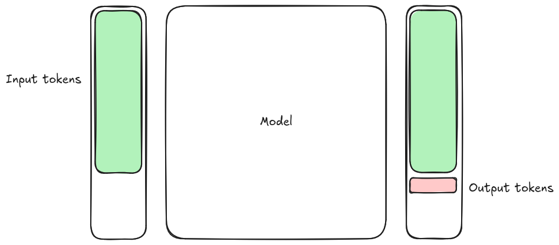
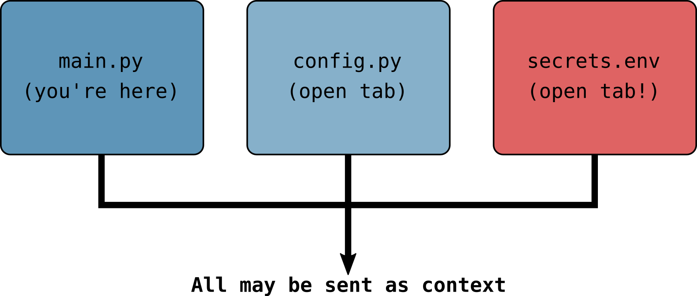
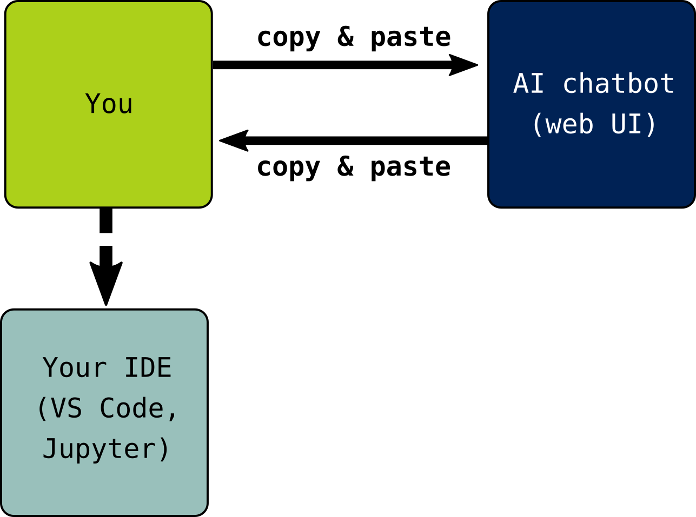
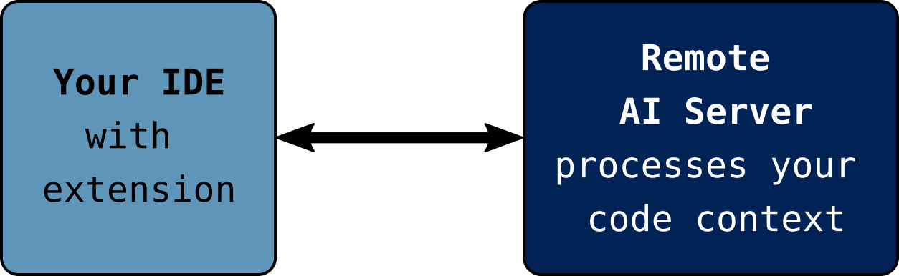
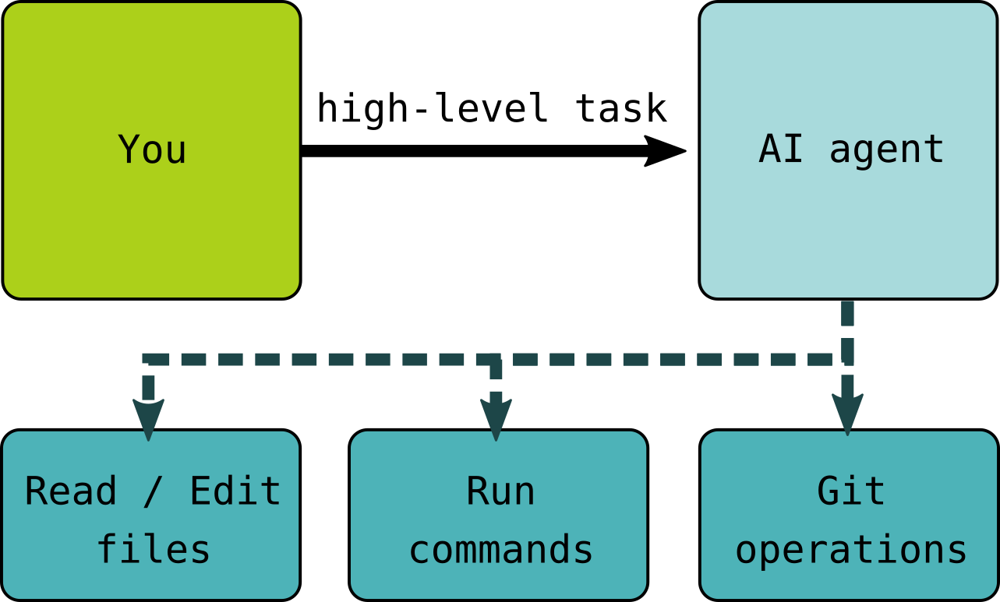
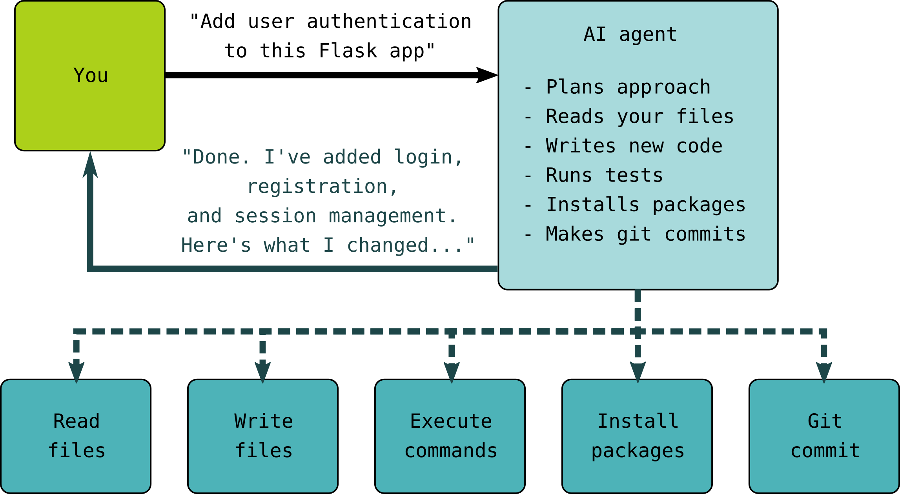
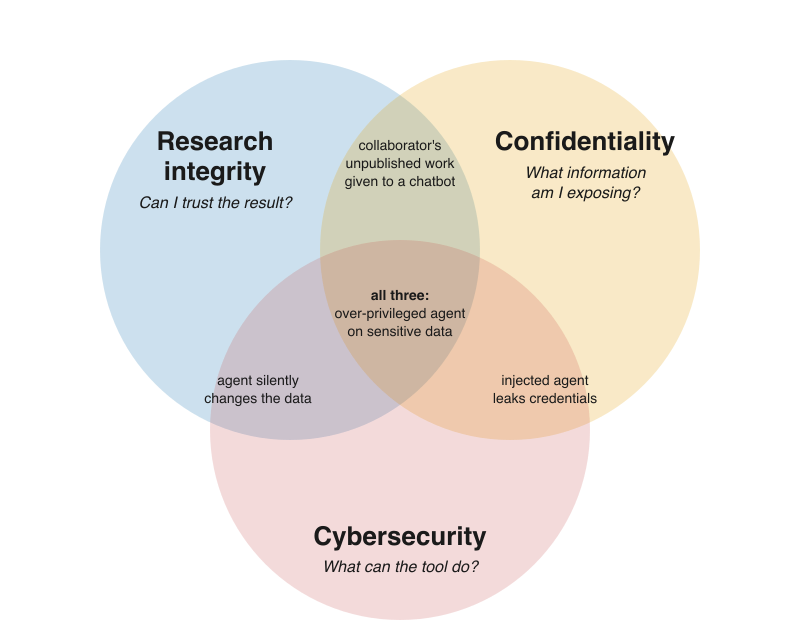

## AI-assisted programming in biology {data-timing="45"}

### *Why learn to programme when AI can write code for you?*

An assistant can help you read a file, make sense of an error or get a first plot on the screen.

Say your plot shows how many animals you saw at two field sites. The count is higher at the site where you spent twice as long watching. **How would you *plot* the data to compare the sites fairly?**

::: {.take}
Before asking for a plot, decide what a fair comparison would mean.
:::

::: notes
Think of a time you were stuck making a plot. An assistant can get the code
started. Once you see the plot, ask what might account for the higher count.
Could it simply be that you spent longer at that site? Listen to one or two
ideas, then move from comparing sites to working out the observation time at
one site.
:::

## Pollinator watches at Meadow {data-timing="45"}

| Watch | Minutes | Pollinator visits |
| --- | ---: | ---: |
| Meadow, morning | 5 | 0 |
| Meadow, afternoon | 10 | 3 |
| Meadow, cancelled | 10 planned | |

::: {.ask}
We want to report visits per minute. How many visits did we see in total, and how many minutes did we actually spend watching?
:::

::: {.take}
A watch can tell you something even when you see zero visits.
:::

::: notes
Give learners time to add the visits and minutes separately. We spent 15
minutes watching and saw three visits, so the rate is 3 divided by 15.
The first watch gave us five minutes of evidence, including the observed
zero. The last row records a plan. Use the extracted practice folder and
the Remember exercise in the chapter. Keep coursework in a separate folder.
:::

# Remember

::: {.take}
Recall what each value in the table represents before you give it to a program.
:::

::: notes
Ask someone to describe the zero in the morning row in their own words.
Then use a small example to explain how a language model suggests code.
:::

## What does a language model generate? {data-timing="75"}

{height=315 fig-alt="Given a function signature, the language model predicts a return statement using patterns learned from code."}

A **large language model (LLM)** learns patterns from text, often including code. Here it takes the first line of a Python function and suggests how to finish it.

::: {.take}
The line looks familiar. What happens if you give it an empty list?
:::

::: notes
“A large language model, or LLM, is a computer model trained on large
collections of text, often including code. Give it the start of a sentence
or a line of code and it predicts what might come next. It builds a reply
by repeating that step.”

Read the proposed line aloud in ordinary language. It adds the numbers and
divides by how many there are. Ask how many numbers are in an empty list and
what happens when you divide by that number. A sensible-looking line can still
need a decision about what to do in a particular case.
:::

## One token at a time {data-timing="75"}

{height=270 fig-alt="Input tokens go into the language model. The original tokens and a new output token appear on the right."}

A **token** is a small piece of text. It might be a word, part of a word or a bracket.

::: {.take}
Each new piece of text helps shape what the model writes next.
:::

::: notes
Say “The total was …” and ask learners for possible next words. After “zero”,
the rest of the sentence might go a different way than it would after “three”.
A model also uses what it has written so far to work out what could come next.
Send learners to the Remember exercise to run the script. Move on to
Understand at minute 10.
:::

# Understand

::: {.take}
Work out why two assistants might give different answers to the same question.
:::

::: notes
An explanation should say which assumption led to each answer. Use the two
replies in the chapter after the introduction to the tools.
:::

## How are code models trained? {data-timing="90"}

**Pre-training.** The model learns patterns from many examples of text and code. It might learn what usually follows the first line of a Python function.

**Instruction tuning.** It sees examples of requests and useful replies, such as how to respond when someone asks, “What does this loop count?”

::: {.take}
Examples can teach a model how to write and explain code. Tell it what the numbers in your own table represent.
:::

::: notes
Minute 10. Explain that instruction tuning is one kind of further training.
OpenCodeInstruct is an example linked in the chapter. It contains requests,
example programs and information about tests. Ask what a good Python example
could teach. Then ask how the assistant would know whether the ten minutes in
a cancelled row were planned or observed.
:::

## Cut-offs and context {data-timing="90"}

{height=190 fig-alt="Three open files in an editor, including a file with secrets, may supply context for a request."}

The model learned from examples collected up to a **cut-off date**. The information it receives for this reply is its **context**. The diagram shows how other open files might be included.

A **library** is a collection of code you can reuse. The Python library pandas gives you functions for working with tables.

::: {.take}
If an assistant suggests a pandas function that’s changed, where would you check what it does in the version you’re using?
:::

::: notes
The model may have learned how a function behaved in an earlier version.
An assistant with a suitable tool can look up newer information and pass it
to the model with the request. Point out the other tabs in the diagram.
The tool and its settings determine which files may be included.
Ask where to find the documentation for the version of pandas installed on
their computer.
:::

## Scenario I · Chat {data-timing="60"}

{height=265 fig-alt="The learner exchanges text with a chatbot and manually copies a reviewed suggestion into an editor."}

Type a question and decide what to try from the reply. What would you tell the assistant about the cancelled watch?

::: {.take}
**Understand → Apply.** Explain why two replies disagree, then try a hint on a case you’ve worked out yourself.
:::

::: notes
Introduce the three scenarios from CodeRefinery. Here you might send a few
synthetic rows and ask whether the planned minutes belong in the calculation.
Use the two replies in the Understand exercise. Ask which assumption each reply
makes about the minutes column and what the learner would add to the request.
:::

## Scenario II · Editor assistance {data-timing="60"}

{height=225 fig-alt="A code editor with an extension communicates with a remote AI server that processes code context."}

In this example, a remote service receives code context from your editor. When the suggestion appears right where you’re typing, it’s called an **inline completion**.

::: {.take}
**Apply → Evaluate.** Read the suggested line in place. Predict what it will do, then try your check before deciding whether to keep it.
:::

::: notes
Show where a suggestion appears in the editor. The words around the cursor
or other material from the project can help produce it. Use the supplied
practice folder and see which files the assistant is showing as context.
There are instructions for VS Code and RStudio in the appendix.
:::

## Scenario III · Agents {data-timing="60"}

{height=275 fig-alt="A person gives an agent a task. Possible actions include reading or editing files, running commands and using Git."}

An **agent** can use tools to open files, edit code and run commands. You give it a task and decide what it may do.

::: {.take}
**Analyse → Evaluate.** Read the plan, then check which files changed and what commands ran.
:::

::: notes
Use the report as the example. You could ask for advice in chat, try a line in
the editor, or let an agent edit the report and run a check. All three can
help with the same task. Ask what the agent would need permission to change.
Move on to Apply at minute 25.
:::

# Apply

::: {.take}
Try a suggestion on a case you can work out by hand.
:::

::: notes
Leave time for learners to write down what they expect before they try the
suggestion or look at the worked answer.
:::

## Check a suggestion before you keep it {data-timing="100"}

1. You watched for five minutes and saw zero visits.
2. You cancelled the watch before it began.

::: {.ask}
What should the program report for each case?
:::

::: {.take}
Write down both answers first. Then try the same two cases on the suggested code.
:::

[Apply exercise](../../notebooks/ai-assisted-programming.html#ai-live-apply)

::: notes
Minute 25. Five minutes with zero visits gives a rate of zero. With no minutes
of observation, there’s no rate to calculate. Keep the answers for discussion
after learners have tried their checks. If Copilot is slow or unavailable,
use the prepared suggestion and the same cases. A third check uses a row that
the program should report as invalid. Take the break at minute 43.
:::

# Analyse

::: {.take}
Follow the values through the code until you see where the answer changes.
:::

::: notes
Ask learners to write down a running total before discussing how to change the
program.
:::

## Where did the extra minutes come from? {data-timing="70"}

Keep a running total of the visits and the time spent watching. Here’s the first row worked out.

| After reading this row | Visits so far | Minutes watched so far |
| --- | ---: | ---: |
| Morning | 0 | 5 |
| Afternoon | ? | ? |
| Cancelled | ? | ? |

::: {.take}
If the time goes up when you read the cancelled row, look for the line that added those minutes.
:::

::: notes
Minute 53. Have learners fill the two rows before revealing the faulty
candidate. The totals after the afternoon are three visits and 15 minutes.
The cancelled row adds neither visits nor minutes watched. Point to the part
of the program that adds minutes and ask when it runs.
:::

## Agent demonstration · one report change {data-timing="200"}

{height=265 fig-alt="An example agent can plan, read and write files, run tests, install packages and make Git commits."}

The diagram shows several actions an agent might take on a larger task. For our survey, ask for one report column. A **diff** shows which lines changed.

::: {.take}
Read the diff. Then check that the new column gives you the minutes you expected and that the visit rate still agrees with your hand calculation.
:::

::: notes
Open the Analyse exercise and the prepared files `report_with_minutes.diff`
and `command-output.txt`. Read the plan before showing the change. It calls for
an edit to the report writer. Ask what the learner would do if an agent also
wanted to edit the test or install something. Show the two changed lines and
run the separate check in the exercise. Ask learners to predict the minutes
and rate for Meadow before showing the output. Use a clean practice folder
for a rehearsed live demonstration, and review what the tool can read or run
before starting. If the live attempt stalls, use the prepared files.
:::

## AI-assisted version control {data-timing="45"}

```diff
-    writer.writerow(["site", "visits_per_minute"])
+    writer.writerow(["site", "observed_minutes", "visits_per_minute"])
```

A minus marks the old line and a plus marks its replacement. This part of the change adds a column heading.

::: {.ask}
What would you check before trusting an AI summary of this change?
:::

::: {.take}
Read the whole diff. Then use Git to **stage** the changes you want to save together.
:::

[Optional practical](../../notebooks/ai-assisted-programming.html#ai-version-control)

::: notes
Spend about 45 seconds here. This excerpt shows a heading. Ask whether it tells
you how the new column was calculated or whether another part of the file
changed. In the optional exercise, learners inspect both groups of changed
lines and run a check involving an observed zero. Staging selects the changes
to put in the next commit, which is a saved version in Git. They draft a
message based on what they actually staged.
:::

# Evaluate

::: {.take}
Decide what you’d keep and explain which check helped you decide.
:::

::: notes
A check gives you evidence to explain your decision to someone else. Ask for
a concrete example from the survey.
:::

## Three questions about the same change {data-timing="110"}

::: {.columns}
::: {.column width="49%"}
{height=330 fig-alt="Three overlapping circles show research integrity, confidentiality and cybersecurity, with examples where they intersect."}
:::
::: {.column width="51%"}
**Does the number make sense?** Check how the rate was calculated.

**May I send this file?** Think about who is allowed to see it.

**What can the tool do?** Check what it can read, change or run.
:::
:::

::: {.take}
These questions can come up together. An agent might open an unpublished survey and then alter the data used to produce a result.
:::

::: notes
Minute 72. Start with the minutes in the survey. If the number is wrong, ask how
that might affect a comparison between sites. Now imagine the file contains
unpublished observations. Who can see the file, and what can the tool do with
it? If a file tells the assistant to run a command, ask whether that action
belongs in the task. Give learners time to think through one case in the
Evaluate exercise.
:::

## Make a decision someone else can check {data-timing="60"}

Say you expect three visits in 15 minutes. The script runs, but divides by 25
minutes after adding the cancelled watch.

What would you change? What would you tell someone who had already used that rate to compare sites?

::: {.take}
Write down the case you checked, the result you got and what you decided to keep or change.
:::

[Evaluate exercise](../../notebooks/ai-assisted-programming.html#ai-live-evaluate)

::: notes
The report can look tidy even if site differences reflect which watches
were cancelled. Ask learners to name the check that caught the mistake and
describe what another person would need to run it. Follow the relevant rules
for recording assistance in coursework or research.
:::

# Create

::: {.take}
Decide what you want to learn from the data before asking for code.
:::

::: notes
Give learners a chance to describe their intended comparison. Ask what
someone reading their report should be able to tell from its numbers.
:::

## Which comparison are you trying to make? {data-timing="110"}

**Use all the time you watched.** Add the visits at a site and divide by the total time you actually spent watching.

**Give each completed watch equal weight.** Work out a rate for each watch, then average those rates.

::: {.take}
Choose a comparison you can explain. Find two watches for which these calculations would give different answers.
:::

::: notes
Minute 90. Ask learners to make a choice and write the steps in plain
language. In the first method every minute gets equal weight. In the
second every watch gets equal weight. What happens if one watch is much
longer than the other? Let learners work out a small case before opening
the worked example. Once they have a plan and a check, they can ask for an
explanation, try a suggested line or give an agent a small edit to make.
:::

## Try this independently {data-timing="45"}

Open the [final exercise](../../notebooks/ai-assisted-programming.html#ai-live-transfer). It gives you a new set of watches and a suggested change.

1. Work out what you expect, then write and run your own check.
2. Decide whether to keep the change and tell us why.
3. Say what the result tells you about the sites you watched.

::: {.take}
Your explanation should make sense to someone who has only the data, the code and your check.
:::

::: notes
Minute 110. Leave ten minutes. Ask each learner to write a check, a decision
and a sentence about the survey. They can open the worked answer after
recording their own decision.
:::

## Sources and figure credits {.smaller data-timing="0"}

Adapted from CodeRefinery, Enrico Glerean, Bjørn Lindi, Ina Pöhner, Jarno
Rantaharju, Simon Christ, Thomas Pfau, Bahareh Tasdighi and Ashwin Mohanan,
*Responsible Use of Generative AI in Assisted Coding*, 2026-11-13.
[DOI 10.5281/zenodo.19335927](https://doi.org/10.5281/zenodo.19335927) ·
[Pinned source](https://github.com/coderefinery/coding-with-ai/tree/d1a0a7049d890f5ebeb9ee6ee713a40d810a2572)

Copyright (c) CodeRefinery. MQB reorganised the lesson around Bloom, developed
the pollinator practical and checks for the workshop. Adapted instructional
material is [CC BY 4.0](https://creativecommons.org/licenses/by/4.0/).
The original MQB scripts and synthetic data carry the [MQB MIT licence](https://github.com/MulQuaBio/MQB/blob/main/LICENSE).

The six categories follow [Krathwohl (2002)](https://doi.org/10.1207/s15430421tip4104_2).
The MQB Collective developed their application to quantitative biology.
The token diagram is credited to Simo Tuomisto.

::: {.take}
Use the chapter to try the exercises. The worksheet helps you work through them in two hours.
:::

[Full chapter and figure credits](../../notebooks/ai-assisted-programming.html#ai-references) ·
[Workshop worksheet](../../appendices/ai-coding-workshop.html) ·
[Copilot setup](../../appendices/vscode-copilot.html)

::: notes
The CodeRefinery introduction supplies the lecture order. The chapter's figure
notice gives the pinned source files and licences for the original figures.
The CodeRefinery Jupyter lesson is credited for the notebook diagrams in the
chapter. The original Imperial ECRI influence on the MQB design is credited
in the chapter.
:::
